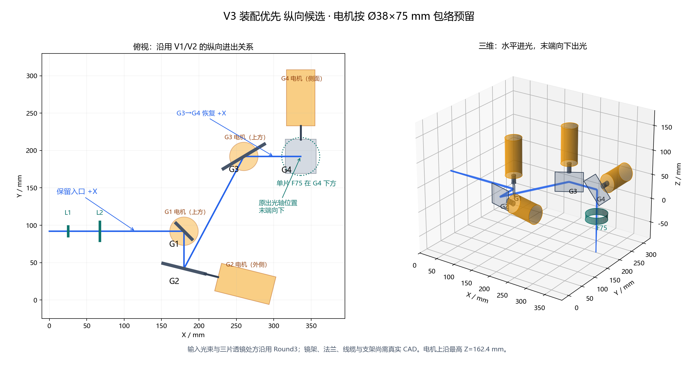
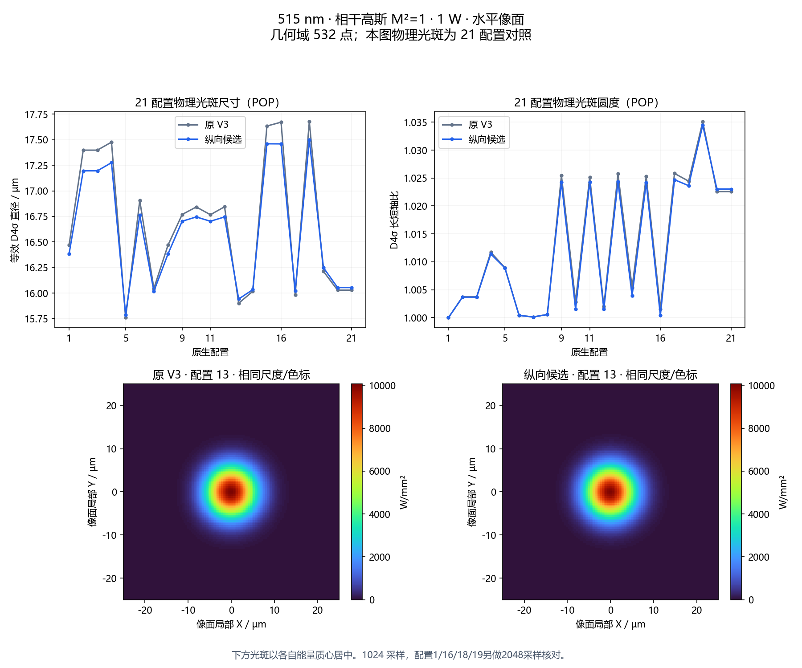

历史记录：本目录描述G1改版前的纵向布局；当前新版见[净空改进说明](../g1_clearance_revision/README.md)。

# V3纵向装配候选：沿V1/V2保留进出关系

2026-10-30，用户说明进出光应类似V1/V2后，停止采用上一版U形候选的末段侧向布局。本候选保留V3原入口、出光轴线及水平像面，在内部重排振镜，为G2电机留出外侧安装空间。由主模型直接完成，未调用子代理。

**工程：[V3_assembly_forward.zos](../V3_assembly_forward.zos)**，21配置、默认5、45顺序面。该候选保存后经21配置曲面、净口径和光线复核，已发布为V3当前默认布局；原水平入口基线保存在`../round3_reference/`。下文保留候选阶段的复核记录。

## 明确的接口约束

V1的`analysis/optics_demo/engine.js`定义入口沿+X，四振镜后经沿X的中继到固定折转镜，再向−Z出光。V2的`simulation/deep_hole_v2/_base/model.py`与`analysis/optics_demo/v2_engine.js`同样保留四振镜后+X及末端向−Z折转。这里保留的是这一前后纵向通道关系，不能将其误写成外部入口与最终向下光束平行。

| 固定项目 | 本候选 |
|---|---|
| 输入基准点与方向 | (0,92,49.4) mm，沿+X |
| 最终下折前方向 | G3→G4沿+X，与输入方向一致 |
| 出光轴线 | X=336.08、Y=192.03 mm，与原V3一致 |
| 标称末段出光 | −Z，G4兼最终下折 |
| 水平像面 | 基准Z=−80 mm，各配置按目标Z变化 |
| 光学输入与处方 | 515 nm、高斯1/e²直径2 mm；沿用Round3三片透镜及原位置 |

扫描时出光方向按目标AOI变化，表中的固定方向为标称零位。没有把入口改成顶部竖直进光。

## 内部布局与装配变化

| 振镜 | 镜心/mm | 数学正转轴 | 电机安装侧 | 镜片外形u×v×厚/mm |
|---|---|---|---|---|
| G1 | (180,92,49.4) | (0,0,1) | 上方 | 30×25×2 |
| G2 | (180,42,49.4) | (0.970153,−0.242495,0) | +轴，朝外侧 | 58×40×2 |
| G3 | (260,192.03,49.4) | (0,0,1) | 上方 | 64×40×2 |
| G4 | (336.08,192.03,49.4) | (0,1,0) | +Y侧 | 58×46×2 |

G1先向−Y，G2再向前斜向G3，G3转为+X，G4最终向下。由此把G2的电机安装方向引向箱体外侧，避免原布局中转轴穿过G1或后续主光路的问题。

镜片口径不能全部沿用同一块大矩形：本轮检查发现，58 mm的G1长边会挡住G2→G3光束，因此按真实足迹缩小为30×25 mm；G3的扩大轮廓需要更长镜面，预留64×40 mm，并同步修改原生工程净口径。G3镜片变大是本轮的负载代价，后续需连同实际转子惯量选型，不能据静态通光认为动态性能已满足。

机体均按Ø38×75 mm、轴段按Ø10 mm预留。G4的v向外形增至46 mm，为更粗轴端留连接区域；其光学净窗口仍为56×38 mm，与已计算的原生工程一致。该机械修订逐项核对光学表面行数据完全不变，因此保留本轮POP结果。G1/G2/G3/G4外部轴段占位长度为16/18.5/18.5/18.5 mm，必须用供应商轴端和镜架设计落实，不是可直接制造的裸轴方案。

镜片与电机可分别从上方和外侧装配；驱动、插头和散热接口向外布置。主箱体止于X=300 mm，G4及其电机在+X端外，G3→G4光束经端壁窗口进入外部G4/F75组件；当前G2电机包络在Y负方向略超出原Y=0边界。端壁窗口、法兰、外部G4支架和出口凸台仍需设计。入口和出口位置固定不代表箱体外形完全不变：G4侧向电机不应再按箱内安装处理。电机最高上沿Z=162.4 mm，机壳壁厚、法兰、镜架、线缆弯曲及工具操作空间尚未设计完成。

## 几何域与机械采样检查

既有532个目标覆盖Ø2.5 mm、Z±1 mm、合成AOI≤7.5°，重新求解后全部可达，最大归一化残差2.36×10⁻¹⁰。四振镜最大绝对指令为1.413°、1.227°、1.972°、1.649°；音圈最大绝对位移3.301 mm，仍在现有±3.5 mm行程内。

每个目标追迹输入中心和半径1.5/2.5 mm的48点轮廓，包括出物镜后到目标像面的线段。保守机体/轴段胶囊包络与旋转镜片盒检查结果：

| 检查项 | 最小值/mm |
|---|---:|
| 电机/轴段到采样光线 | 3.112 |
| 电机/轴段到其他镜片盒 | 29.741 |
| 电机/轴段之间 | 43.442 |
| 镜片盒之间投影分离下界 | 27.245 |

采样光线与非预期镜片盒相交次数为0。输入2.5 mm轮廓内理论高斯源功率比例99.999627%，这不是系统透过率。包含每边1 mm预留的足迹尺寸为：G1 13.29×9.78、G2 15.20×9.79、G3 60.40×23.95、G4 43.18×30.26 mm，均落在当前候选外形内。

这仅通过所列姿态与对象的采样检查，未完成连续扫掠体或真实硬件CAD验收；镜架、法兰、螺钉、轴承接口、线缆、机壳与装配公差仍需纳入。

## 原生Zemax与POP

保存并重新打开工程，21配置均完成原生光线与独立Python/C++求交对照，最大位置差小于4×10⁻¹² mm，像面全部水平。三片透镜的曲率、Conic、A4/A6、厚度和位置未优化，全部控制指令已按新布局重算。

原V3和本候选各重算21配置POP，统一515 nm、相干高斯M²=1、1 W、1024×1024采样及水平像面。结果：

| 指标 | 原V3 | 纵向候选 |
|---|---:|---:|
| 等效D4σ直径范围/µm | 15.758～17.677 | 15.787～17.500 |
| 最大D4σ长短轴比 | 1.03508 | 1.03448 |

同目标比较，等效D4σ直径最大增加0.2632%，D95最大增加0.3171%；单主轴D4σ最大绝对变化1.2567%，包含变小的情况。等效直径为两主轴直径的几何平均。

配置1/16/18/19另做2048×2048核对，D4σ最大采样差0.00825%，D95最大采样差0.00751%。在这些配置中，布局调整未造成明显物理光斑退化。

POP只覆盖21配置，不是532点全域物理光斑验收。仍为理想静态相干模型，未纳入实测M²、偏振镀膜、镜面形变、装配误差和伺服动态；未重算Ø100 µm×深1 mm孔道POP，不继承旧结构的孔道结论。

## 文件与复现

- [原生工程](../V3_assembly_forward.zos)；[五轴配置表](../forward_reference/configurations.csv)。
- 分析设置：[点列图](../forward_reference/V3_spot.CFG)、[POP](../forward_reference/V3_pop.CFG)。加载对应工程和CFG，切换配置后刷新。
- [汇总](summary.json)、[532点几何/机械数据](candidate.json)、[原生光线及POP记录](native_report.json)。
- 完整光强网格保存在各`baseline_XX_pop.npz`、`candidate_XX_pop.npz`及`candidate_hi_XX_pop.npz`文件中。

复现命令：指定Python运行`simulation/v3/assembly_forward.py`，再运行`simulation/v3/build_assembly_native.py --forward`及`simulation/v3/summarize_assembly.py --forward`。正式V3基线哈希核对通过；发布后副本的保存态复核见[../forward_publish_audit.json](../forward_publish_audit.json)，网页检查见[../browser_verification.json](../browser_verification.json)。
